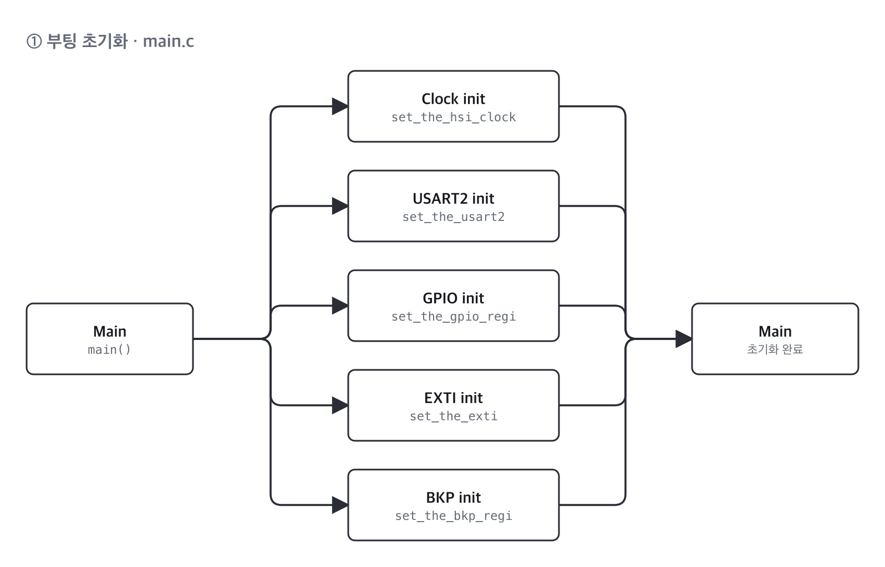
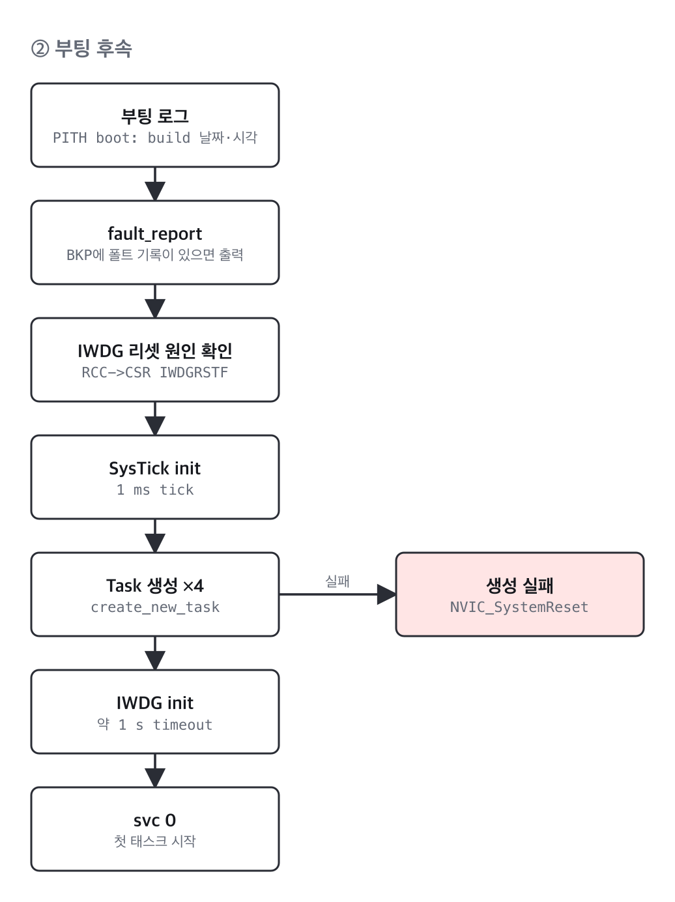
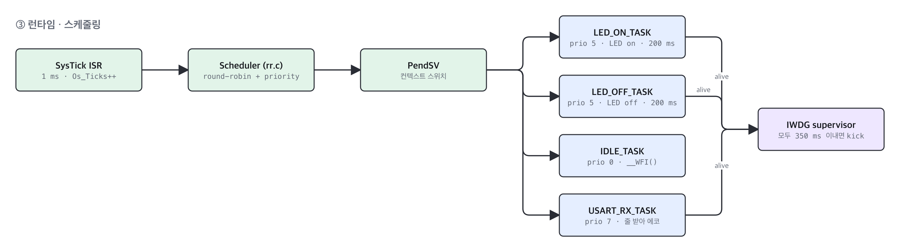
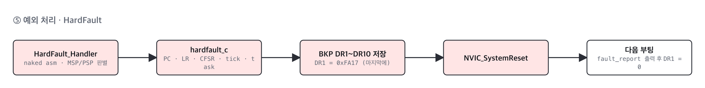

# pith
Zero to one Nucleo — HAL 없이 레지스터부터 만드는 STM32 베어메탈 RTOS
-----
#### 구현 내용
- **클럭**: HSI + PLL로 36MHz 설정, GPIO/AFIO/EXTI/USART/PWR/BKP 클럭까지 전부 레지스터 직접 조작 (HAL 미사용)
- **스케줄러**: SysTick(1 ms) 기반 preemptive round-robin + priority 스케줄링, 타임 슬라이스 10 tick. `SVC_Handler`가 첫 태스크를 부팅하고, `PendSV_Handler`가 실제 컨텍스트 스위칭(R4-R11 저장/복원, PSP 스왑) 담당
- **태스크 관리**: TCB 풀(최대 10개) 기반 태스크 생성/관리, `task_delay`로 voluntary blocking, 스택 오버플로 캐너리(canary)로 태스크별 스택 보호. 태스크 생성 실패 시 TCB 롤백
- **Idle 태스크**: 우선순위 0의 `__WFI()` 루프. 모든 태스크가 대기 중이어도 스케줄러가 항상 실행할 태스크를 확보
- **GPIO/EXTI**: 버튼 인터럽트(EXTI15_10)로 UART 로그 트리거
- **UART**: USART2 register-level 드라이버. TX는 폴링 방식(`usart2_send_char`/`usart2_send_string`), RX는 RXNE 인터럽트 + 256 B 링 버퍼, 줄 단위 조립(`usart2_receive_string`)
- **동기화**: PRIMASK(IRQ masking) 기반 spinlock mutex(`mutex_lock`/`mutex_unlock`)로 태스크·ISR이 공유하는 UART 송신 자원을 보호
- **Watchdog**: IWDG(약 1 s). 태스크별 alive 보고 후 supervisor가 모든 태스크가 350 ms 이내에 응답했을 때만 kick. 부팅 시 `RCC->CSR`로 IWDG 리셋 원인 확인
- **HardFault 대응**: `HardFault_Handler`가 폴트 시점의 PC / LR / CFSR / `Os_Ticks` / 태스크 번호를 BKP 레지스터(DR1~DR10)에 저장하고 리셋, 다음 부팅의 `fault_report()`가 UART로 출력 후 지움
- **부팅 가드**: 태스크 생성에 실패하면 `NVIC_SystemReset()`으로 재시작

#### 구조
**① 부팅 초기화** — `main()`이 클럭, USART2, GPIO, EXTI, BKP를 차례로 초기화한다.



**② 부팅 후속** — 부팅 로그와 폴트 기록 출력, IWDG 리셋 원인 확인, SysTick 시작, 태스크 4개 생성, IWDG 시작, `svc 0`으로 첫 태스크를 띄운다.



**③ 런타임 · 스케줄링** — SysTick ISR이 tick을 올리고 스케줄러가 다음 태스크를 고르면 PendSV가 컨텍스트를 바꾼다. 각 태스크는 IWDG supervisor에 alive를 보고한다.



**④ 인터럽트** — 버튼은 mutex를 잡고 UART로 로그를 출력하고, 수신 바이트는 USART2 ISR이 링 버퍼에 쌓아 `USART_RX_TASK`가 줄 단위로 읽는다.


**⑤ 예외 처리 · HardFault** — 폴트 정보를 BKP에 남기고 리셋한 뒤, 다음 부팅에서 출력한다.



#### 빌드
```
cd firmware
make          # build/pith.bin 생성
make flash    # ST-Link 드라이브(NOD_*)로 복사
```
macOS/Linux는 `run.sh`로도 빌드할 수 있다.

#### Data sheet
[Data sheet 보러가기](https://www.st.com/resource/en/reference_manual/cd00171190-stm32f101-103-105-107-stm32f100-series-armbased-32bit-mcus-stmicroelectronics.pdf)

#### TIL
[관련 TIL 보러가기](https://github.com/ilfpns/IL/tree/main/Projects/pith)
