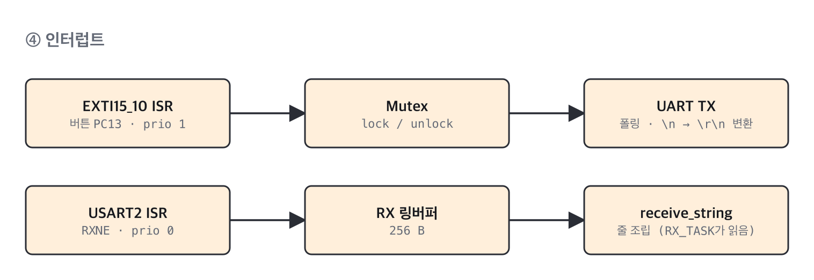

# pith
Zero to one Nucleo — HAL 없이 레지스터부터 만드는 STM32 베어메탈 RTOS
-----
#### 구현 내용
- **클럭**: HSI + PLL로 36MHz 설정, GPIO/AFIO/EXTI/USART/PWR/BKP 클럭까지 전부 레지스터 직접 조작 (HAL 미사용)
- **스케줄러**: SysTick(1 ms) 기반 preemptive round-robin + priority 스케줄링, 타임 슬라이스 10 tick. `SVC_Handler`가 첫 태스크를 부팅하고, `PendSV_Handler`가 실제 컨텍스트 스위칭(R4-R11 저장/복원, PSP 스왑) 담당
- **태스크 관리**: TCB 풀(최대 10개) 기반 태스크 생성/관리, `task_delay`로 voluntary blocking, 스택 오버플로 캐너리(canary)로 태스크별 스택 보호. 태스크 생성 실패 시 TCB 롤백
- **Idle 태스크**: 우선순위 0의 `__WFI()` 루프. 모든 태스크가 대기 중이어도 스케줄러가 항상 실행할 태스크를 확보
- **GPIO/EXTI**: 버튼 인터럽트(EXTI15_10)로 UART 로그 트리거
- **UART**: USART2 register-level 드라이버. TX는 256 B 링 버퍼 + TXE 인터럽트 방식(`usart2_send_char`/`usart2_send_string`)이라 호출 측이 전송 완료를 기다리지 않고, `\n`은 `\r\n`으로 변환해 큐에 넣는다. 링이 가득 차면 태스크는 비워질 때까지 기다리고 인터럽트 마스크 상태에서는 문자를 버린다. 리셋·정지 직전에는 `usart2_flush()`로 큐와 마지막 바이트 전송을 기다린다. RX는 RXNE 인터럽트 + 256 B 링 버퍼, 줄 단위 조립(`usart2_receive_string`). 수신한 줄은 `User input : ...`으로 되돌려 출력
- **동기화**: PRIMASK(IRQ masking) 기반 spinlock mutex(`mutex_lock`/`mutex_unlock`). 버튼 ISR이 쓰는 mutex는 태스크 컨텍스트에서 잡는 동안 해당 IRQ(`MUTEX_INIT_IRQ`)를 마스크해, 락을 쥔 태스크를 ISR이 선점해 스핀하는 데드락을 막는다
- **Watchdog**: IWDG(약 1 s). IWDG를 시작한 뒤 PR/RLR을 설정하고 kick하는 순서로 초기화. 태스크별 alive 보고 후 supervisor가 모든 태스크가 500 ms 이내에 응답했을 때만 kick. 부팅 시 `RCC->CSR`로 IWDG 리셋 원인 확인
- **HardFault 대응**: `HardFault_Handler`가 폴트 시점의 PC / LR / CFSR / `Os_Ticks` / 태스크 번호를 BKP 레지스터(DR1~DR10)에 저장하고 리셋, 다음 부팅의 `fault_report()`가 UART로 출력 후 지움. 보드에서 폴트 주입 테스트로 검증함(아래 "폴트 주입 테스트")
- **부팅 가드**: 태스크 생성에 실패하면(같은 malloc 실패가 리셋 후에도 반복되므로) 메시지를 flush한 뒤 정지

#### 구조
**① 부팅 초기화** — `main()`이 클럭, USART2, GPIO, EXTI, BKP를 차례로 초기화한다.


**② 부팅 후속** — 부팅 로그와 폴트 기록 출력, IWDG 리셋 원인 확인, 태스크 4개 생성, IWDG 시작, SysTick 시작, `svc 0`으로 첫 태스크를 띄운다. SysTick은 첫 태스크 시작 직전에 켠다(그 전에 켜면 `svc 0` 전에 PendSV가 걸려 폴트가 난다).


**③ 런타임 · 스케줄링** — SysTick ISR이 tick을 올리고 스케줄러가 다음 태스크를 고르면 PendSV가 컨텍스트를 바꾼다. LED 두 태스크는 400 ms 주기로 200 ms 어긋나게 켜고 끄고, 각 태스크는 IWDG supervisor에 alive를 보고한다.


**④ 인터럽트** — 버튼은 mutex를 잡고 UART로 로그를 출력하고, 수신 바이트는 USART2 ISR이 링 버퍼에 쌓아 `USART_RX_TASK`가 줄 단위로 읽어 `User input : ...`으로 출력한다.



**⑤ 예외 처리 · HardFault** — 폴트 정보를 BKP에 남기고 리셋한 뒤, 다음 부팅에서 출력한다. `FAULT_TEST` 빌드에서는 UART로 `fault N`을 입력해 폴트를 일으킬 수 있다.


#### 빌드
```
cd firmware
make          # build/pith.bin 생성
make flash    # ST-Link 드라이브(NOD_*)로 복사
make DEBUG_BUILD=1   # 디버깅용 빌드 (sleep 중에도 SWD 접속 가능, DBGMCU DBG_SLEEP 설정)
```
macOS/Linux는 `run.sh`로도 빌드할 수 있다. macOS에서 `cp`가 xattr 오류를 내면 `cp -X`로 복사한다.

#### 폴트 주입 테스트
`FAULT_TEST`를 켜고 빌드하면 UART로 `fault N` + Enter를 입력해 의도적으로 폴트를 일으킬 수 있다. 재부팅 후 `fault_report()`가 출력한 값으로 BKP 저장·복원을 확인한다. 일반 빌드에는 포함되지 않는다.
```
cd firmware
make FAULT_TEST=1     # 테스트 빌드 (FAULT_TEST=1 ./run.sh 도 가능)
make                  # 일반 빌드로 되돌리기
```

| 입력 | 폴트 | 기대 CFSR |
|---|---|---|
| `fault 1` | 매핑되지 않은 주소에 쓰기 | 버스 에러 비트(쓰기 버퍼 때문에 `0x0400`으로 나올 수 있음) |
| `fault 2` | 함수 포인터 0 호출 | `0x00020000` (INVSTATE) |
| `fault 3` | 정의되지 않은 명령(`udf`) | `0x00010000` (UNDEFINSTR) |
| `fault 4` | 0으로 나누기 (`CCR.DIV_0_TRP`) | `0x02000000` (DIVBYZERO) |
| `fault 5` | 정렬되지 않은 접근 (`CCR.UNALIGN_TRP`) | `0x01000000` (UNALIGNED) |
| `fault 7` | ISR 안에서 폴트 | `0x00010000`, `LR=0xFFFFFFFD` |
| `fault 8` | 폴트 없는 일반 리셋 | 리포트가 나오지 않아야 함 |

#### Data sheet
[Data sheet 보러가기](https://www.st.com/resource/en/reference_manual/cd00171190-stm32f101-103-105-107-stm32f100-series-armbased-32bit-mcus-stmicroelectronics.pdf)

#### TIL
[관련 TIL 보러가기](https://github.com/ilfpns/IL/tree/main/Projects/pith)
